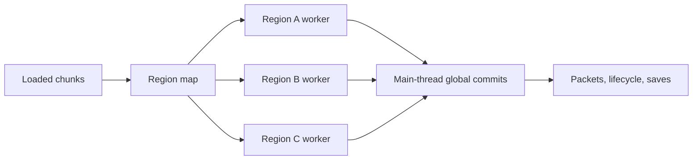

# wcpu

wcpu is a performance mod for Minecraft 1.21.1 (NeoForge) that lets a server use more than one CPU
core for the game world. It splits the loaded world into independent regions and ticks them on
different cores. If one region gets too expensive it is slowed down on its own instead of dragging
the whole server below 20 TPS.

> **Origin.** wcpu is a fork of [Tessellate](https://github.com/ColinVaughn/Tessellate) by
> ColinVaughn (MIT license, see `LICENSE`). The region/ownership machinery is his work. This fork
> adds load-based scheduling, `/wcpu` commands, built-in compatibility rules and removes all network
> contact. It is developed for a Create / Sable / Create Big Cannons server.

**Status:** private test build. It is tested on NeoForge 21.1 only. The Fabric module comes from
upstream, still compiles, and is not tested in this fork.

## What wcpu does

| Situation | What wcpu does |
| --- | --- |
| Several distant bases are busy | Ticks their regions concurrently on worker threads |
| One region exceeds the server budget | Reduces only that region's simulation rate |
| Two regions get close enough to interact | Merges them before they tick |
| One core is overloaded, others idle | Groups regions by measured cost and lets idle workers steal tasks |
| A worker needs a chunk that is not loaded yet | Pauses parallel ticking for about 5 seconds, then resumes by itself |
| A worker reaches state that is really unsafe | Falls back to serial ticking until the server restarts |

It helps most when players or chunk loaders are spread out. One dense base or machine cluster is
still one region, so wcpu cannot spread that work over several cores. It does not replace
single-thread optimizers such as [Lithium](https://modrinth.com/mod/lithium).

### Added in this fork

- **Load metrics and balancing.** Each region's cost is measured per tick. A planner groups regions
  into tasks (heavy regions alone, light ones together) and a persistent work-stealing pool runs
  them. See `/wcpu balance` and `/wcpu workers`.
- **Soft chunk misses.** Requesting an unloaded chunk (Sable assembling a structure, a projectile
  flying into new terrain) only pauses parallel ticking briefly. Real safety violations still
  switch to serial for the session.
- **Sable support.** Workers can see Sable's far-away "plot" chunks, and structure assembly no
  longer breaks parallel ticking.
- **Built-in compatibility rules** (`BuiltInCompatibility`), enabled automatically when the mod is
  installed: Ritchie's Projectile Library and Create Big Cannons projectiles run on the main thread,
  Simulated block entities run on the main thread. Entity lists accept ids, `mod:*` and `#tag`.
- **`/wcpu` commands** with a readable report (colours, bars, hover and click). Every setting can be
  read and changed in chat with `/wcpu config`.
- **No network.** No compatibility reports are uploaded and no rules are downloaded. Nothing leaves
  the host.

---

## How it works




Each worker handles the local simulation for its region. Anything that touches shared Minecraft or
mod state is queued and applied on the main thread once the region is safe.

### Regions

wcpu divides the loaded world into **sections** of 4x4 chunks. Nearby entity-ticking sections are
joined into a **region**, and that whole region ticks as one unit.

With the default settings, regions merge when they come within 2 sections of each other. Two
separate regions are therefore at least 3 sections (192 blocks) apart, far enough that one cannot
reach the other during a single tick.

The map updates as chunks load and unload. Run `/wcpu regions` to see it.

### Regional TPS: slicing, not skipping

wcpu measures the cost of each region every tick. If the server is about to miss its tick-time
target, the most expensive region gets a **tick divisor**. A divisor of 4 runs that region at 5 TPS
while unaffected regions can stay at 20.

Running the whole region once every fourth tick would produce the right average rate, but it feels
awful in play:

| | gated (all work every 4th tick) | sliced (1/4 of the work every tick) |
| --- | --- | --- |
| bystander's TPS | 19.6 | **20.0** |
| MSPT, mean | 20.5 ms | 23.7 ms |
| MSPT, **95th percentile** | **210.9 ms** | **32.9 ms** |

That gated version caused a 200 ms hitch every fourth tick, which made everyone stutter. wcpu
instead runs a quarter of the region's entities on every tick. Each entity still averages 5 TPS,
but the work is spread out.

Entity IDs and block positions determine slice membership, so the same mob or hopper stays in the
same slice each cycle.

The throttle looks at the whole tick before deciding whether to step in. Chunk work, networking,
and block entities outside regions all consume time that regions cannot control, so the available
region budget is whatever remains under `targetTickMillis`. If the server is comfortably holding
20 TPS, nothing is throttled.

### Parallel region ticking

Separate regions cannot interact during a tick, which makes it possible to run them on different
threads. The harder part is keeping every shared boundary safe:

- **Entity storage is sharded by grid cell.** Vanilla keeps every entity section in one map plus
  one balanced tree. Sharding by *cell* rather than by region matters: a section key's coordinates
  are chunk coordinates, so the shard is a pure function of the key, and regions merging or
  splitting migrates nothing.
- **Entity lifecycle callbacks run on the main thread.** One entity crossing a chunk section
  updates six level-global containers: entity tracking, the player list, mob navigation, dragon
  parts, game-event listeners, and the mod event bus. Workers queue those and the main thread
  replays them, which replaces six concurrency problems with one rule.
- **Scheduled ticks are region-owned.** Each region has an ordinary vanilla `LevelTicks` child;
  chunk tick containers move between children at quiescent topology changes. Owner-local writes
  stay on the worker and cross-owner writes are handed off.
- **Block events are region-owned.** Each region has an ordered, deduplicating queue. Its block
  callbacks run on the owner worker; only successful event packets and positional sound/network
  effects are committed on the main thread.

Most simulation stays on the region worker. Shared work crosses one of these measured boundaries:

| boundary | region-worker work | main-thread commit or global barrier |
| --- | --- | --- |
| scheduled block/fluid ticks | drain the region-owned vanilla `LevelTicks` child | cross-owner scheduling is handed to the destination owner |
| chunk/random ticks | tick with worker-local vanilla random state | chunk/player broadcasts and packet delivery |
| entity ticks | core entity simulation | add/remove lifecycle, persistent callbacks, and entity insertion |
| teleports/dimension changes | request the transition | replay the transition after the source owner is idle |
| block-entity ticks | core block-entity simulation | ticker and fresh block-entity registration |
| block events | ordered owner callback queue | successful packets and positional sound/network effects |
| natural spawning | independent searches with one snapshot and atomic cap reservations | entity insertion and vanilla spawn-state replay |
| custom spawners/mod callbacks | none | arbitrary global mod code remains main-threaded |
| commands | none | quiesce all owners, drain handoffs, then execute the whole command |
| autosave/chunk unload | none while the owner is active | busy autosaves retry and direct saves lease the owner; optional C2ME can serialize unload snapshots on its workers |
| explicit saves and shutdown | none | quiesce and drain before taking the global snapshot or closing storage |
| topology merge/split | none while owners are active | wait affected owners, drain against old ownership, then replace the map |

`/wcpu phases` reports queued, replayed, direct, pending, elapsed main-thread time, failures,
balance, and the last source region for each boundary. The counters are bounded by boundary type;
they do not retain an ever-growing region history.

With `asyncRegionLoops=true`, a busy region keeps its ownership claim and only misses its own next
slot. Other regions and the main server tick continue instead of waiting at a global barrier.
Targeted leases protect packets, commands, chunk topology, entity loading and unloading, and saves.

wcpu runs this ownership path without C2ME and has no build, metadata, or class dependency on it.
Vanilla prepares a safe unload snapshot on the main thread and writes it asynchronously. If C2ME is
installed, it can also run `ChunkSerializer.write` for that snapshot on its workers. Loaded
autosaves are still serialized during an idle main-thread slice; they do not wait on a busy region.

---

## The trade-off

Throttling has an intentional cost: when a region exceeds its share, **everything inside it runs
slower**. Mobs move more slowly, farms produce less, and hoppers move fewer items. That is useful for
containing a lag machine, but wcpu cannot tell a lag machine from a legitimately busy base. It
will slow either one.

If you would rather let the whole server drop below 20 TPS than slow a player's build, set
`regions.adaptiveThrottling = false`. Region tracking stays on and you keep the `/wcpu regions`
diagnostics.

---

---

## Configuration

File: `config/wcpu-common.toml`. Every option can also be changed in game with
`/wcpu config <setting> <value>`, which saves the file and applies it immediately, except the
options marked "restart" below: those are saved but only apply after the server restarts, because
they are read while a world is being built. A setting file from the old Tessellate
(`tessellate-common.toml`) is not read.

| option | default | what it does |
| --- | --- | --- |
| `regions.enabled` | `true` | region tracking; off makes the mod inert. **restart** |
| `regions.sectionShift` | `2` | region grid granularity, 4x4 chunks. **restart** |
| `regions.mergeRadius` | `2` | regions closer than this many sections are merged |
| `regions.verifyIntervalTicks` | `200` | how often the region map is rescanned for drift |
| `regions.parallelTicking` | `true` | tick regions on worker threads |
| `regions.workerThreads` | `0` | worker threads; `0` is automatic (CPU cores minus 2) |
| `regions.asyncRegionLoops` | `true` | independent per-region loops without a per-tick barrier |
| `regions.parallelNaturalSpawning` | `true` | owner-region spawn searches run concurrently |
| `regions.directWorkerChunkReads` | `true` | workers read loaded chunks directly |
| `regions.threadLocalRandom` | `true` | per-thread random state; required by `parallelTicking` |
| `regions.shardEntityStorage` | `true` | entity storage isolation required by `parallelTicking`. **restart** |
| `regions.scopedEntityTicking` | `true` | tick entities per region |
| `regions.scopedBlockEntityTicking` | `true` | tick block entities per region |
| `regions.scopedScheduledTicks` | `true` | region-owned block/fluid scheduled ticks. **restart** |
| `regions.scopedBlockEvents` | `true` | region-owned block-event queues |
| `regions.adaptiveThrottling` | `true` | the regional TPS system (see the trade-off below) |
| `regions.budgetMillis` | `25.0` | minimum budget kept for region work |
| `regions.targetTickMillis` | `45.0` | tick time to steer toward; raise to intervene later |
| `regions.minThrottleMillis` | `2.0` | regions cheaper than this are never slowed |
| `regions.maxTickDivisor` | `16` | slowest a region may be driven (1.25 TPS) |
| `regions.assertShardOwnership` | `false` | debug check of entity-storage ownership |
| `compatibility.serializeEntityTicks` | `false` | entity tick bodies never overlap across workers |
| `compatibility.mainThreadEntities` | `["creaturefeature:toadstool", "#ritchiesprojectilelib:precise_motion"]` | entity types ticked on the main thread. Accepts ids, `mod:*` and `#namespace:tag`. Built-in rules add Create Big Cannons projectiles automatically |
| `compatibility.forceSerialMods` | `[]` | loaded mod IDs that force serial region ticking |
| `guard.diagnoseEntitySectionRaces` | `false` | log suspected entity-section races |
| `guard.strict` | `false` | stricter ownership guard |
| `guard.logRegionChanges` | `false` | log region merges and splits |

The four `compatibility.*Endpoint` / `*ApiKey` options remain in the file for old configs. They do
nothing: this build never contacts a server and they are hidden from `/wcpu config`.

JVM flags (add to the server start script; they override the file):

| flag | what it does |
| --- | --- |
| `-Dwcpu.workerThreads=N` | worker thread count |
| `-Dwcpu.balance=false` | turn load balancing off |
| `-Dwcpu.maxConcurrentRegionTasks=N` | cap on regions running at once |
| `-Dwcpu.chunkMissPauseMs=N` | how long parallel ticking pauses after a chunk miss (default 5000) |

To go back to serial regional ticking while diagnosing a mod conflict, set both of these to `false`:

```toml
regions.parallelTicking = false
regions.asyncRegionLoops = false
```

### Commands

All commands need operator permission level 2.

| command | what it does |
| --- | --- |
| `/wcpu status` | one-screen summary with a verdict: mode, workers, regions, load, problems |
| `/wcpu regions [all]` | region map with per-region cost, tick rate and worker; click a region to get a teleport command. `raw` and `verbose` give the old plain-text output |
| `/wcpu balance [on\|off]` | show the load-balancing plan, or switch balancing on or off |
| `/wcpu workers [N\|all\|auto]` | show worker threads, or set their number (`all` = every CPU core, `auto` = default) |
| `/wcpu phases [raw]` | where time goes: worker and main-thread work per boundary, queue depth, failures |
| `/wcpu violations [clear]` | thread-ownership violations recorded since start (should be empty) |
| `/wcpu visualize [on\|off]` | show region and chunk borders in the world (needs the mod on the client for the full overlay; otherwise particles are used) |
| `/wcpu config` | list every setting; hover shows the description, default and range, click to edit |
| `/wcpu config <setting>` | show one setting with its description |
| `/wcpu config <setting> <value>` | change a setting, save it and apply it (restart-only settings are saved and apply after a restart) |
| `/wcpu config reset <setting>` | restore the default |

Tab completion works on settings and values and shows the description as a tooltip.

When Lithium is installed, wcpu disables Lithium's `alloc.chunk_random`,
`entity.inactive_navigations` and experimental `entity.block_caching` mixins through Lithium's
supported override metadata. They keep mutable state shared by independent region threads; wcpu
supplies worker-local random state and an atomic path-type cache instead.

---

## Compatibility

Mods whose entity tick touches main-thread-only state can opt that entity type out of region workers
during mod initialization:

```java
wcpuApi.registerMainThreadEntity(MyEntityTypes.MY_ENTITY.get());
```

wcpu will tick those entities on the server thread. The same can be done without code through `compatibility.mainThreadEntities`, and common cases (Create Big Cannons, Ritchie's Projectile Library, Simulated) are built in. Registration is process-wide and
idempotent; register only the affected types so other entities retain parallel ticking. wcpu
waits for all active regions before replaying a whole entity tick because its interaction range is
unknown. Block entities have the same safety fallback:

```java
wcpuApi.registerMainThreadBlockEntity(MyBlockEntityTypes.MACHINE.get());
```

Treat whole-type registration as a safety fallback, not the normal compatibility fix. Most mods can
keep mob ticks parallel by fixing their shared state and isolating only the unsafe operation. A
`ConcurrentHashMap` can solve independent map-access races, but changing the collection alone does
not make compound read/modify/write sequences, iteration plus mutation, or invariants spanning
several objects thread-safe.

Prefer clear ownership, atomic operations, a lock around the full invariant, immutable snapshots,
or the appropriate `executeOnRegion`/`executeOnMainThread` boundary. Use
`registerMainThreadEntity` only when the entire tick truly cannot be made safe; most mobs should not
need it after the underlying code is corrected.

If only one operation is unsafe, keep the entity tick parallel and hand off just that operation:

```java
wcpuApi.executeOnMainThread(() -> updateMainThreadOnlyState());
```

Calls are always queued and return before the operation runs, so code after this call cannot depend
on its result.

World access should stay on the region that owns its position. Owner-local calls run immediately;
cross-region and external-thread calls are queued for the current owner:

```java
wcpuApi.executeOnRegion(level, machinePos, () -> {
    BlockEntity blockEntity = level.getBlockEntity(machinePos);
    if (blockEntity instanceof MyMachine machine) {
        machine.acceptTransfer(amount);
    }
});
```

Use `wcpuApi.ownsCurrentRegion(level, pos)` to select an owner-local fast path, or
`requireCurrentRegion(level, pos)` as a development assertion. `isRegionThread()` reports whether
the current call has a wcpu region ownership scope; it does not mistake an unrelated async
thread for the server thread.

Main-thread code that touches a known world position should use the positional overload. It leases
the target owner before running while unrelated regions continue:

```java
wcpuApi.executeOnMainThread(level, machinePos,
    () -> updateMainThreadOnlyWorldState(level, machinePos));
```

---

## Limitations

wcpu protects the shared state it knows about, but it cannot make unknown mod code thread-safe.

- **Other mods can still introduce races.** A mod that keeps its own unsafe global state can still
  race. Runtime fallbacks always log the suspected mod and source frame locally; nothing is sent
  anywhere, so reports only exist in the chat message and the log.
- **Chunk generation.** A region worker cannot wait for a chunk to generate. While chunks are being
  generated, parallel ticking pauses for a few seconds and the affected region may skip part of one
  tick. Pre-generating the area avoids this.
- **Tested setup.** Development is checked against Create, Sable, Simulated, Create Big Cannons and
  Ritchie's Projectile Library on NeoForge 21.1.x. Other mods are untested. The Fabric module is
  inherited from upstream and not tested here.
- The unit tests and GameTests that run in CI cover the region machinery, not every mod
  interaction.
- Upstream Tessellate published benchmark numbers for a many-region setup; they were measured on
  different hardware and a different mod set and are not repeated here. Measure on your own server
  with `/wcpu status` and `/wcpu phases`.

---

## Building

GitHub Actions builds every push (`Build JAR` workflow, artifact `wcpu-neoforge`). Locally:

```
./gradlew build                 # requires JDK 21
./gradlew runGameTestServer     # NeoForge GameTests
./gradlew runServer             # dev server with RCON on 25585
```

The scripts in `tools/` are inherited from upstream (benchmarks and verification against a running
dev server). They read the RCON password from `WCPU_RCON_PASSWORD`; use the same value for
`rcon.password` in the dev server's `server.properties`. They have not been re-run for this fork.

## License

MIT, see `LICENSE`. Copyright of the original Tessellate code belongs to its author; the fork's
changes are under the same license.
