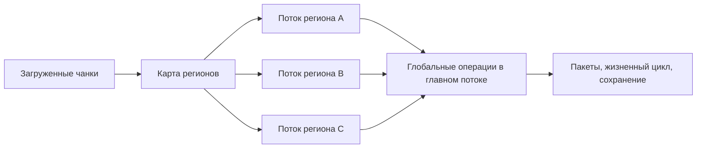

# wcpu

[English version](README.md)

wcpu — мод для повышения производительности Minecraft 1.21.1 (NeoForge). Он позволяет серверу использовать
больше одного ядра процессора для игрового мира: делит загруженный мир на независимые регионы и
обрабатывает их на разных ядрах. Если один регион становится слишком дорогим, замедляется только он, а не
весь сервер целиком.

> **Происхождение.** wcpu — форк [Tessellate](https://github.com/ColinVaughn/Tessellate) автора
> ColinVaughn (лицензия MIT, см. `LICENSE`). Вся механика регионов и владения — его работа. Этот форк
> добавляет планирование по нагрузке, команды `/wcpu`, встроенные правила совместимости и полностью
> убирает сетевые обращения. Разрабатывается для сервера с Create / Sable / Create Big Cannons.

**Статус:** закрытая тестовая сборка. Проверялась только на NeoForge 21.1. Модуль Fabric достался от
оригинала, компилируется, но в этом форке не тестировался.

## Что делает wcpu

| Ситуация | Что делает wcpu |
| --- | --- |
| Несколько удалённых баз заняты работой | Обрабатывает их регионы одновременно в рабочих потоках |
| Один регион превышает бюджет сервера | Снижает скорость симуляции только этого региона |
| Два региона сблизились настолько, что могут взаимодействовать | Объединяет их до обработки |
| Одно ядро перегружено, остальные простаивают | Группирует регионы по измеренной нагрузке, свободные потоки забирают задачи |
| Рабочему потоку нужен ещё не загруженный чанк | Приостанавливает параллельную обработку примерно на 5 секунд и сама возобновляет её |
| Рабочий поток дошёл до действительно небезопасного состояния | Переходит на последовательную обработку до перезапуска сервера |

Больше всего пользы, когда игроки или загрузчики чанков разбросаны по миру. Одна плотная база или
скопление механизмов остаётся одним регионом, поэтому wcpu не может разложить такую нагрузку на несколько ядер.
Мод не заменяет оптимизаторы одного потока, такие как [Lithium](https://modrinth.com/mod/lithium).

### Что добавлено в этом форке

- **Метрики нагрузки и балансировка.** Стоимость каждого региона измеряется каждый тик. Планировщик
  группирует регионы в задачи (тяжёлые отдельно, лёгкие вместе), а постоянный пул потоков с кражей
  задач их выполняет. См. `/wcpu balance` и `/wcpu workers`.
- **Мягкие промахи чанков.** Запрос незагруженного чанка (Sable собирает структуру, снаряд летит в
  новую местность) лишь ненадолго приостанавливает параллельную обработку. Настоящие нарушения
  безопасности по-прежнему переводят сервер на последовательную обработку до перезапуска.
- **Поддержка Sable.** Рабочие потоки видят удалённые «plot»-чанки Sable, а сборка структур больше не
  ломает параллельную обработку.
- **Встроенные правила совместимости** (`BuiltInCompatibility`) включаются сами, когда установлен
  нужный мод: снаряды Ritchie's Projectile Library и Create Big Cannons обрабатываются в главном потоке,
  блочные сущности Simulated — тоже. Списки сущностей принимают id, `mod:*` и `#тег`.
- **Команды `/wcpu`** с читаемым отчётом (цвета, полосы, подсказки при наведении и клики). Любую настройку
  можно прочитать и изменить прямо в чате через `/wcpu config`.
- **Никакой сети.** Отчёты о совместимости не отправляются, правила не скачиваются. Ничего не покидает
  хост.

---

## Как это работает



Каждый рабочий поток обрабатывает локальную симуляцию своего региона. Всё, что затрагивает общее
состояние Minecraft или модов, ставится в очередь и применяется в главном потоке, когда регион
безопасен.

### Регионы

wcpu делит загруженный мир на **секции** 4x4 чанка. Близкие секции с тикающими сущностями объединяются
в **регион**, и весь регион обрабатывается как единое целое.

При настройках по умолчанию регионы объединяются, если находятся ближе 2 секций друг к другу. Значит,
два отдельных региона разделены минимум 3 секциями (192 блока) — достаточно, чтобы один не мог
повлиять на другой за один тик.

Карта обновляется по мере загрузки и выгрузки чанков. Посмотреть её можно командой `/wcpu regions`.

### TPS по регионам: нарезка, а не пропуск

wcpu измеряет стоимость каждого региона каждый тик. Если сервер вот-вот не уложится в целевое время тика,
самый дорогой регион получает **делитель тиков**. Делитель 4 запускает регион на 5 TPS, пока остальные
регионы остаются на 20.

Если выполнять весь регион раз в четыре тика, средняя скорость будет правильной, но играть так
неприятно:

| | «стробирование» (вся работа каждый 4-й тик) | нарезка (1/4 работы каждый тик) |
| --- | --- | --- |
| TPS у соседей | 19.6 | **20.0** |
| MSPT, среднее | 20.5 мс | 23.7 мс |
| MSPT, **95-й перцентиль** | **210.9 мс** | **32.9 мс** |

Из-за «стробирования» каждый четвёртый тик возникала задержка в 200 мс, и все игроки ощущали рывки.
Поэтому wcpu каждый тик обрабатывает четверть сущностей региона. Каждая сущность по-прежнему получает в
среднем 5 TPS, но работа распределена равномерно.

Принадлежность к «ломтю» определяется идентификатором сущности и позицией блока, поэтому один и тот же
моб или воронка попадает в один и тот же ломоть в каждом цикле.

Регулятор смотрит на весь тик целиком, прежде чем вмешаться. Работа с чанками, сеть и блочные сущности
вне регионов тоже занимают время, которое регионы контролировать не могут, поэтому бюджет регионов — это
то, что остаётся до `targetTickMillis`. Если сервер уверенно держит 20 TPS, ничего не замедляется.

### Параллельная обработка регионов

Разные регионы не могут взаимодействовать внутри одного тика, поэтому их можно выполнять в разных
потоках. Сложнее обеспечить безопасность каждой общей границы:

- **Хранилище сущностей разбито по ячейкам сетки.** В ванильной версии все секции сущностей лежат в
  одной карте и одном сбалансированном дереве. Разбиение именно по *ячейкам*, а не по регионам, важно:
  координаты ключа секции — это координаты чанка, поэтому шард однозначно определяется ключом, и при
  слиянии или разделении регионов ничего не переносится.
- **Обратные вызовы жизненного цикла сущностей выполняются в главном потоке.** Переход сущности между
  секциями чанка обновляет шесть глобальных для уровня контейнеров: отслеживание сущностей, список
  игроков, навигацию мобов, части дракона, слушатели игровых событий и шину событий модов. Рабочие
  потоки ставят эти операции в очередь, а главный поток их воспроизводит: шесть проблем многопоточности
  заменяются одним правилом.
- **Запланированные тики принадлежат регионам.** У каждого региона есть обычный ванильный дочерний
  `LevelTicks`; контейнеры тиков чанков переходят между ними при спокойных изменениях топологии.
  Локальные записи остаются в рабочем потоке, а записи в чужой регион передаются владельцу.
- **Блочные события принадлежат регионам.** У каждого региона своя упорядоченная очередь без дубликатов.
  Обратные вызовы блоков выполняются в потоке владельца; в главном потоке фиксируются только
  успешные пакеты событий и позиционные звуковые/сетевые эффекты.

Большая часть симуляции остаётся в потоке региона. Общая работа проходит через одну из этих границ:

| граница | работа в потоке региона | фиксация в главном потоке или глобальный барьер |
| --- | --- | --- |
| запланированные тики блоков/жидкостей | обработка региональной ванильной очереди `LevelTicks` | запись в чужой регион передаётся владельцу |
| тики чанков/случайные тики | тик с локальным для потока состоянием генератора | рассылка чанков/игрокам и доставка пакетов |
| тики сущностей | основная симуляция сущности | добавление/удаление, постоянные обратные вызовы, вставка сущности |
| телепорты/смена измерения | запрос перехода | воспроизведение перехода после простоя исходного владельца |
| тики блочных сущностей | основная симуляция блочной сущности | регистрация тикера и новой блочной сущности |
| блочные события | упорядоченная очередь обратных вызовов владельца | успешные пакеты и позиционные звуки/сетевые эффекты |
| естественный спавн | независимый поиск по одному снимку, атомарное резервирование лимитов | вставка сущности и воспроизведение ванильного состояния спавна |
| кастомные спавнеры/обратные вызовы модов | нет | произвольный глобальный код модов остаётся в главном потоке |
| команды | нет | останавливает всех владельцев, сливает передачи, затем выполняет команду целиком |
| автосохранение/выгрузка чанков | нет, пока владелец активен | занятые автосохранения повторяются, прямые сохранения берут владельца в аренду; C2ME при наличии может сериализовать снимки выгрузки в своих потоках |
| явные сохранения и остановка | нет | остановка и слив очередей до глобального снимка или закрытия хранилища |
| слияние/разделение топологии | нет, пока владельцы активны | ожидание затронутых владельцев, слив по старому владению, затем замена карты |

`/wcpu phases` показывает для каждой границы число поставленных в очередь, воспроизведённых, прямых и
ожидающих операций, затраченное время главного потока, ошибки, баланс и последний исходный регион.
Счётчики ограничены числом типов границ и не накапливают бесконечную историю регионов.

При `asyncRegionLoops=true` занятый регион сохраняет право владения и пропускает только свой следующий
слот. Остальные регионы и главный тик сервера продолжают работать, а не ждут на общем барьере. Точечная
аренда защищает пакеты, команды, топологию чанков, загрузку и выгрузку сущностей и сохранения.

wcpu работает по этой схеме владения без C2ME и не зависит от него ни на уровне сборки, ни метаданных,
ни классов. Ванильная версия готовит безопасный снимок выгрузки в главном потоке и записывает его
асинхронно. Если установлен C2ME, он дополнительно может выполнять `ChunkSerializer.write` для этого
снимка в своих потоках. Автосохранения загруженных чанков по-прежнему сериализуются в свободном слоте
главного потока и не ждут занятый регион.

---

## Компромисс

У замедления есть намеренная цена: когда регион превышает свою долю, **всё внутри него работает
медленнее**. Мобы двигаются медленнее, фермы производят меньше, воронки переносят меньше предметов. Это
полезно для сдерживания «лаг-машины», но wcpu не отличает лаг-машину от действительно загруженной базы
и замедлит и ту, и другую.

Если вы предпочитаете, чтобы весь сервер проседал ниже 20 TPS, но постройки игроков не замедлялись,
поставьте `regions.adaptiveThrottling = false`. Отслеживание регионов останется включённым, диагностика
`/wcpu regions` тоже.

---

## Конфигурация

Файл: `config/wcpu-common.toml`. Любую опцию можно изменить и в игре командой
`/wcpu config <настройка> <значение>`: файл сохранится, а значение применится сразу — кроме опций с
пометкой «restart» ниже. Они сохраняются, но вступают в силу только после перезапуска сервера, потому
что считываются при построении мира. Файл настроек старого Tessellate (`tessellate-common.toml`) не
читается.

| опция | по умолчанию | что делает |
| --- | --- | --- |
| `regions.enabled` | `true` | отслеживание регионов; если выключить, мод ничего не делает. **restart** |
| `regions.sectionShift` | `2` | размер ячейки сетки регионов, 4x4 чанка. **restart** |
| `regions.mergeRadius` | `2` | регионы ближе этого числа секций объединяются |
| `regions.verifyIntervalTicks` | `200` | как часто карта регионов перепроверяется на расхождения |
| `regions.parallelTicking` | `true` | обрабатывать регионы в рабочих потоках |
| `regions.workerThreads` | `0` | число рабочих потоков; `0` — автоматически (ядра процессора минус 2) |
| `regions.asyncRegionLoops` | `true` | независимые циклы регионов без барьера на каждый тик |
| `regions.parallelNaturalSpawning` | `true` | поиск мест для спавна в регионах выполняется одновременно |
| `regions.directWorkerChunkReads` | `true` | рабочие потоки читают загруженные чанки напрямую |
| `regions.threadLocalRandom` | `true` | отдельное состояние генератора случайных чисел на поток; нужно для `parallelTicking` |
| `regions.shardEntityStorage` | `true` | изоляция хранилища сущностей, нужная для `parallelTicking`. **restart** |
| `regions.scopedEntityTicking` | `true` | тики сущностей по регионам |
| `regions.scopedBlockEntityTicking` | `true` | тики блочных сущностей по регионам |
| `regions.scopedScheduledTicks` | `true` | запланированные тики блоков/жидкостей принадлежат регионам. **restart** |
| `regions.scopedBlockEvents` | `true` | очереди блочных событий принадлежат регионам |
| `regions.adaptiveThrottling` | `true` | региональная система TPS (см. «Компромисс» выше) |
| `regions.budgetMillis` | `25.0` | минимальный бюджет, сохраняемый для работы регионов |
| `regions.targetTickMillis` | `45.0` | целевое время тика; увеличьте, чтобы вмешательство начиналось позже |
| `regions.minThrottleMillis` | `2.0` | регионы дешевле этого значения никогда не замедляются |
| `regions.maxTickDivisor` | `16` | максимальное замедление региона (1,25 TPS) |
| `regions.assertShardOwnership` | `false` | отладочная проверка владения хранилищем сущностей |
| `compatibility.serializeEntityTicks` | `false` | тела тиков сущностей не пересекаются между рабочими потоками |
| `compatibility.mainThreadEntities` | `["creaturefeature:toadstool", "#ritchiesprojectilelib:precise_motion"]` | типы сущностей, обрабатываемые в главном потоке. Принимает id, `mod:*` и `#namespace:tag`. Встроенные правила сами добавляют снаряды Create Big Cannons |
| `compatibility.forceSerialMods` | `[]` | id модов, при наличии которых регионы обрабатываются последовательно |
| `guard.diagnoseEntitySectionRaces` | `false` | записывать в лог подозрения на гонки секций сущностей |
| `guard.strict` | `false` | более строгая защита владения |
| `guard.logRegionChanges` | `false` | записывать в лог слияния и разделения регионов |

Четыре опции `compatibility.*Endpoint` / `*ApiKey` остались в файле ради старых конфигов. Они ничего не
делают: эта сборка никогда не обращается к серверам, а в `/wcpu config` они скрыты.

Флаги JVM (добавляются в скрипт запуска сервера; приоритетнее файла):

| флаг | что делает |
| --- | --- |
| `-Dwcpu.workerThreads=N` | число рабочих потоков |
| `-Dwcpu.balance=false` | выключить балансировку нагрузки |
| `-Dwcpu.maxConcurrentRegionTasks=N` | предел числа одновременно выполняемых регионов |
| `-Dwcpu.chunkMissPauseMs=N` | на сколько приостанавливается параллельная обработка после промаха чанка (по умолчанию 5000) |

Чтобы вернуться к последовательной обработке регионов при поиске конфликта модов, поставьте оба параметра в `false`:

```toml
regions.parallelTicking = false
regions.asyncRegionLoops = false
```

### Команды

Для всех команд нужен уровень оператора 2.

| команда | что делает |
| --- | --- |
| `/wcpu status` | сводка на один экран с вердиктом: режим, потоки, регионы, нагрузка, проблемы |
| `/wcpu regions [all]` | карта регионов со стоимостью, частотой тиков и потоком каждого; клик по региону подставляет команду телепорта. `raw` и `verbose` выводят старый текстовый формат |
| `/wcpu balance [on\|off]` | показать план балансировки или включить/выключить её |
| `/wcpu workers [N\|all\|auto]` | показать рабочие потоки или задать их число (`all` — все ядра процессора, `auto` — по умолчанию) |
| `/wcpu phases [raw]` | куда уходит время: работа потоков и главного потока по границам, глубина очередей, ошибки |
| `/wcpu violations [clear]` | нарушения владения потоками с момента запуска (список должен быть пуст) |
| `/wcpu visualize [on\|off]` | показать границы регионов и чанков в мире (для полного оверлея мод нужен на клиенте; иначе используются частицы) |
| `/wcpu config` | список всех настроек; при наведении видны описание, значение по умолчанию и диапазон, по клику можно изменить |
| `/wcpu config <настройка>` | показать одну настройку с описанием |
| `/wcpu config <настройка> <значение>` | изменить настройку, сохранить и применить (настройки «restart» сохраняются и вступают в силу после перезапуска) |
| `/wcpu config reset <настройка>` | вернуть значение по умолчанию |

Автодополнение по Tab работает для настроек и значений и показывает описание в подсказке.

Если установлен Lithium, wcpu отключает его миксины `alloc.chunk_random`, `entity.inactive_navigations` и
экспериментальный `entity.block_caching` через поддерживаемые Lithium метаданные переопределения. Они
хранят изменяемое состояние, общее для независимых потоков регионов; вместо них wcpu предоставляет
локальный для потока генератор случайных чисел и атомарный кеш типов путей.

---

## Совместимость

Моды, у которых тик сущности затрагивает состояние, доступное только из главного потока, могут при
инициализации вывести этот тип сущности из рабочих потоков регионов:

```java
WcpuApi.registerMainThreadEntity(MyEntityTypes.MY_ENTITY.get());
```

wcpu будет тикать такие сущности в серверном потоке. То же самое можно сделать без кода через
`compatibility.mainThreadEntities`, а частые случаи (Create Big Cannons, Ritchie's Projectile Library,
Simulated) уже встроены. Регистрация действует на весь процесс и идемпотентна; регистрируйте только
затронутые типы, чтобы остальные сущности сохранили параллельную обработку. Перед воспроизведением
целого тика сущности wcpu ждёт все активные регионы, потому что радиус её взаимодействия неизвестен. Для
блочных сущностей действует тот же запасной вариант:

```java
WcpuApi.registerMainThreadBlockEntity(MyBlockEntityTypes.MACHINE.get());
```

Регистрация целого типа — это страховка, а не обычное решение проблемы совместимости. Большинство модов
могут оставить тики мобов параллельными, исправив общее состояние и изолировав только небезопасную
операцию. `ConcurrentHashMap` решает независимые гонки при доступе к карте, но замена одной коллекции
не делает потокобезопасными составные последовательности «прочитать-изменить-записать», итерацию с
одновременным изменением и инварианты, охватывающие несколько объектов.

Предпочтительны чёткое владение, атомарные операции, блокировка вокруг всего инварианта, неизменяемые
снимки или подходящая граница `executeOnRegion`/`executeOnMainThread`. `registerMainThreadEntity`
используйте, только если весь тик действительно нельзя сделать безопасным; после исправления
базового кода большинству мобов она не понадобится.

Если небезопасна только одна операция, оставьте тик сущности параллельным и передайте в главный поток
лишь её:

```java
WcpuApi.executeOnMainThread(() -> updateMainThreadOnlyState());
```

Вызовы всегда ставятся в очередь и возвращаются до выполнения операции, поэтому код после вызова не может
зависеть от её результата.

Доступ к миру должен оставаться в регионе, которому принадлежит позиция. Локальные вызовы выполняются
сразу; вызовы в чужой регион и из внешних потоков ставятся в очередь текущему владельцу:

```java
WcpuApi.executeOnRegion(level, machinePos, () -> {
    BlockEntity blockEntity = level.getBlockEntity(machinePos);
    if (blockEntity instanceof MyMachine machine) {
        machine.acceptTransfer(amount);
    }
});
```

`WcpuApi.ownsCurrentRegion(level, pos)` позволяет выбрать быстрый локальный путь, а
`requireCurrentRegion(level, pos)` — проверка на этапе разработки. `isRegionThread()` сообщает, есть ли у
текущего вызова область владения региона wcpu; посторонний асинхронный поток он за серверный не принимает.

Код главного потока, работающий с известной позицией в мире, должен использовать перегрузку с позицией.
Она берёт в аренду целевого владельца перед выполнением, а остальные регионы продолжают работать:

```java
WcpuApi.executeOnMainThread(level, machinePos,
    () -> updateMainThreadOnlyWorldState(level, machinePos));
```

Lithium требует особого внимания, потому что его оптимизация спавна напрямую читает внутренности
хранилища сущностей. Шардированное хранилище wcpu сохраняет этот путь. Блочные сущности регионов также
могут одновременно регистрировать слушателей границы мира Lithium, поэтому wcpu сериализует именно этот
метод регистрации, а не блокирует целые тики вокруг внутреннего `WeakHashMap` Lithium.

---

## Ограничения

wcpu защищает общее состояние, о котором знает, но не может сделать потокобезопасным неизвестный код модов.

- **Другие моды всё ещё могут порождать гонки.** Мод со своим небезопасным глобальным состоянием
  по-прежнему может создавать гонки. Запасные переходы в рантайме всегда пишут в локальный лог
  подозреваемый мод и исходный фрейм; ничто никуда не отправляется, поэтому отчёты есть только в
  сообщении в чате и в логе.
- **Генерация чанков.** Рабочий поток региона не может ждать генерации чанка. Пока чанки генерируются,
  параллельная обработка приостанавливается на несколько секунд, а затронутый регион может пропустить
  часть одного тика. Избежать этого помогает предварительная генерация территории.
- **Проверенная конфигурация.** Разработка проверяется с Create, Sable, Simulated, Create Big Cannons и
  Ritchie's Projectile Library на NeoForge 21.1.x. Остальные моды не тестировались. Модуль Fabric
  унаследован от оригинала и здесь не проверялся.
- Модульные тесты и GameTest, которые запускаются в CI, покрывают механику регионов, а не все
  взаимодействия с модами.
- Оригинальный Tessellate публиковал результаты бенчмарка для конфигурации с несколькими регионами; они
  измерены на другом оборудовании и с другим набором модов, поэтому здесь не повторяются. Измеряйте на
  своём сервере с помощью `/wcpu status` и `/wcpu phases`.

---

## Сборка

GitHub Actions собирает каждый пуш (workflow `Build JAR`, артефакт `wcpu-neoforge`). Локально:

```
./gradlew build                 # нужен JDK 21
./gradlew runGameTestServer     # GameTest для NeoForge
./gradlew runServer             # тестовый сервер с RCON на 25585
```

Скрипты в `tools/` унаследованы от оригинала (бенчмарки и проверки на запущенном тестовом сервере). Они
читают пароль RCON из `WCPU_RCON_PASSWORD`; используйте то же значение в `rcon.password` в
`server.properties` тестового сервера. Для этого форка они заново не запускались.

## Лицензия

MIT, см. `LICENSE`. Авторские права на исходный код Tessellate принадлежат его автору; изменения форка
распространяются на тех же условиях.
